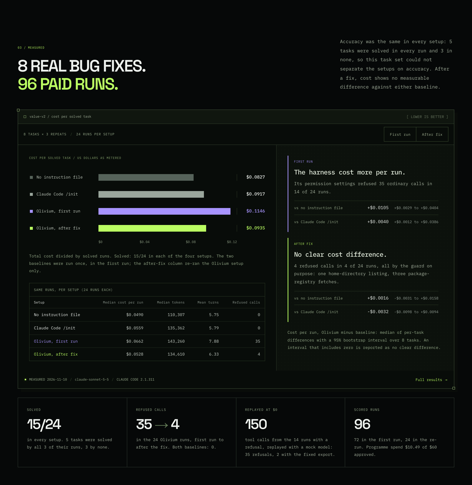
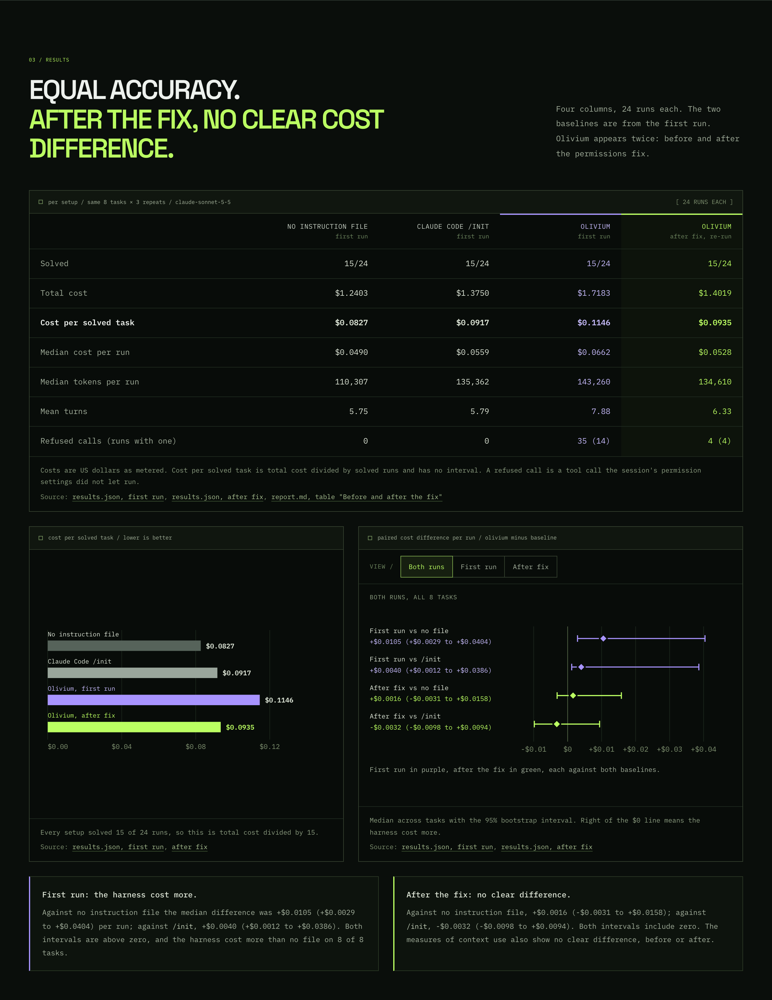
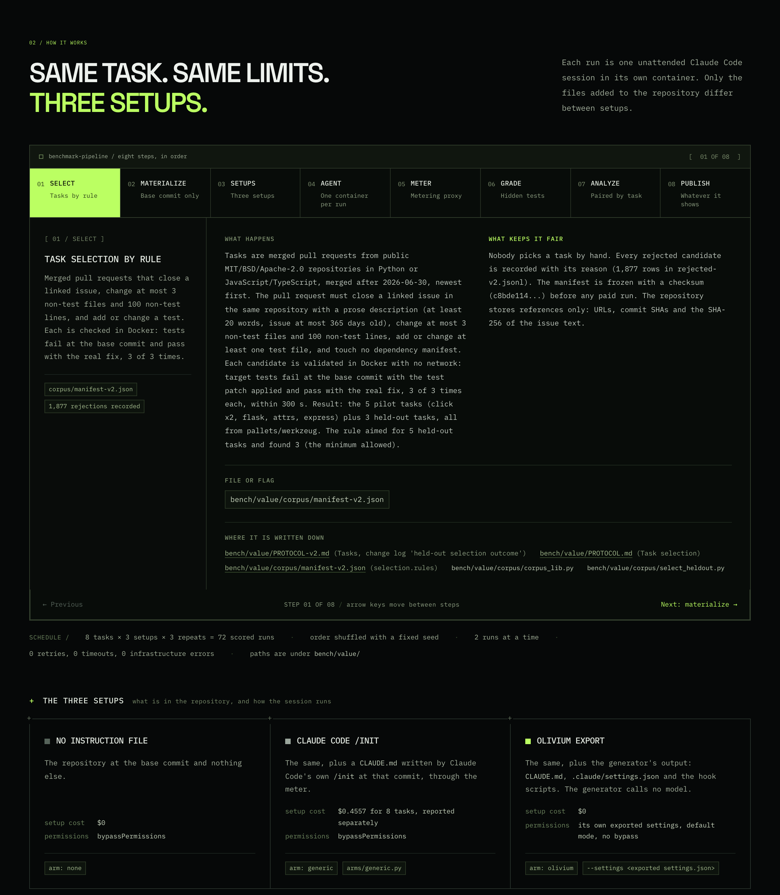
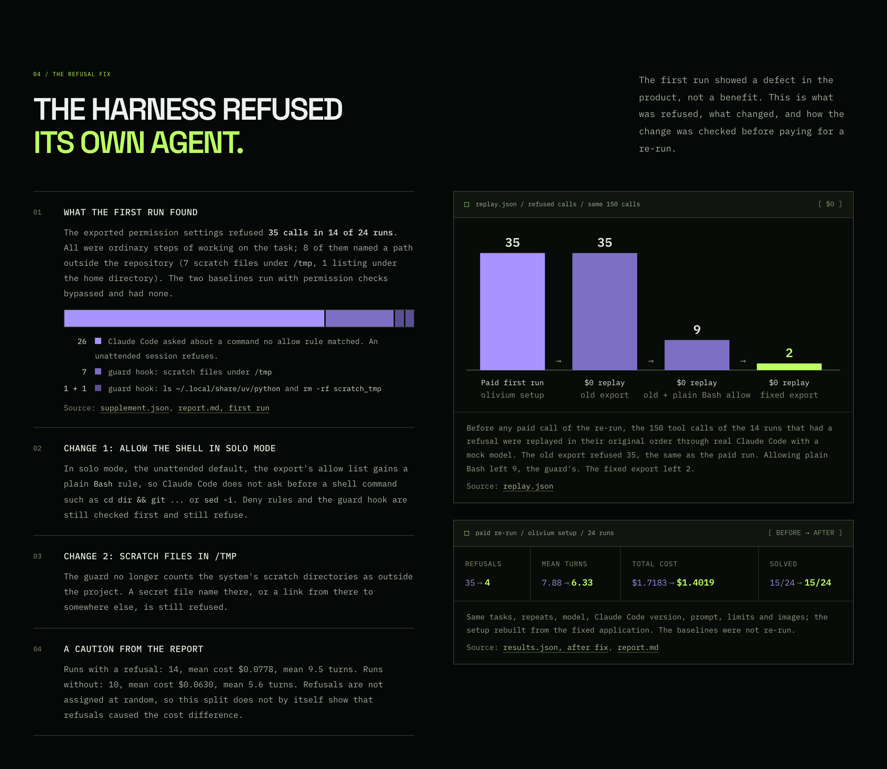
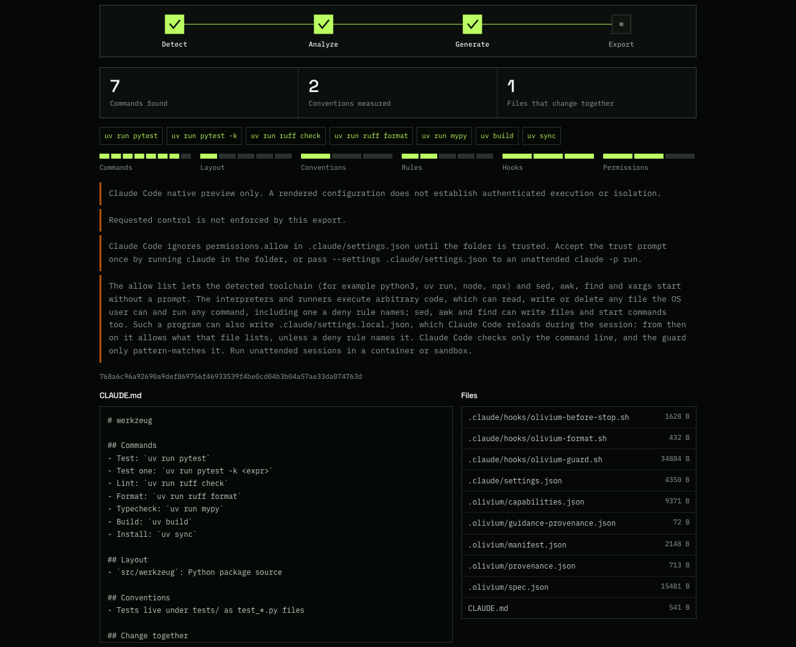

# Olivium Harness

<p align="center">
  
</p>

Olivium Harness reads a git repository and writes a Claude Code harness for it: a short `CLAUDE.md`, a `.claude/settings.json` with permission rules and a context profile, hook scripts, and, when the git history supports them, up to 3 skills and 2 subagents built from that history. `generate` parses the repository's files and history. It runs nothing from the repository and calls no model, so the same commit gives the same files. An experimental `learn` command adds an AI step; see [Context profiles](#context-profiles). It is for developers who run Claude Code unattended on their own repositories and want the setup generated and inspectable instead of written by hand.

It is a local Elixir/OTP application (code name HarnessForge) with a command line and a Phoenix LiveView portal.

[Website](https://oudaykhaled.github.io/olivium-harness-site/) · [Benchmark page](https://oudaykhaled.github.io/olivium-harness-site/benchmark.html) · [Quick start](#quick-start) · [Benchmark](#benchmark) · [Safety model](#safety-model) · [Documentation](#documentation)

**What the tests found.**

- **The one large measured saving is a settings change.** The default `lean` profile turns off about 15 Claude Code tools these runs never used, and the git instructions. On 8 development tasks it used 0.39x the tokens of no harness (0.75x in dollars) and solved the same number. The same two settings alone gave 0.37x. Any user could set them by hand.
- **Beyond the settings, gains are small or absent.** The generated `CLAUDE.md` and hooks, and an experimental AI step that learns from the repository's history, did not use fewer tokens or solve more than the settings alone. An experimental output shaper used 0.80x the tokens of the settings alone on 7 development tasks, with the same solve rate; more than half of that saving came from one task.
- **A re-run of the 8 benchmark tasks (2026-11-14) found fewer tokens and no clear cost difference.** The current default export used a median of 53,197 fewer tokens per run than no harness (95% interval 16,825 to 72,241 fewer; 65,976.5 against 108,861 tokens per run). Cost per run showed no clear difference: −$0.0039 (−$0.0093 to +$0.0162). It solved 18 of 24 against 15 of 24, but all 3 extra solves came from one task, so the per-task median difference is 0. The generator was tuned on these tasks, so this is not a held-out result.
- **The skills and subagents built from history showed no measured effect.** In that re-run a generated skill was called in 6 of 24 runs, all on two tasks that no setup solved, and no run started a subagent. Against the same export without them, tokens, cost and solved share showed no difference the data can tell from zero; the export without them had the lowest median tokens per run (43,249). In a capture without a model they add about 3,500 to 3,800 tokens to every request when both kinds are written (the listing is capped at 1,200 bytes). See [Generated skills and agents](#generated-skills-and-agents).
- **There is no held-out result yet.** An attempt on 24 held-out tasks stopped before scoring because the task selection was flawed.

The re-run and the earlier benchmark are [below](#benchmark), and the other later tests are under [Development tests after the benchmark](#development-tests-after-the-benchmark).

**Status:** development candidate, version 0.1.0. See [current status and limits](docs/status.md).

## What you get

The export for a small Python package (the `CLAUDE.md` and `.claude/` files are the golden fixture in [`test/harness_forge/generation/golden/python_package`](test/harness_forge/generation/golden/python_package); an export also writes `.olivium/`):

```text
CLAUDE.md                                285 B
.claude/settings.json                  4,534 B
.claude/hooks/olivium-guard.sh        38,854 B
.claude/hooks/olivium-before-stop.sh  11,285 B
.claude/hooks/olivium-env-check.sh     1,566 B
.olivium/                              spec, provenance, capability report, manifest
```

| File | What it does |
| --- | --- |
| `CLAUDE.md` | At most 600 bytes: only lines the agent cannot guess and that change the patch. Commands, layout and process lines are left out; each left-out line is listed with its reason in `.olivium/guidance-provenance.json`. |
| `.claude/settings.json` | Permission rules for an unattended `claude -p` run in default mode, the context profile and the three hooks. In the golden export: 48 allow rules including a bare `Bash`, 118 deny rules (15 of them the `lean` profile's tools), 0 ask rules. |
| `.claude/hooks/olivium-guard.sh` | PreToolUse hook. It only refuses and never approves: secret files, paths outside the project other than `/tmp` scratch files, recursive deletes, package downloads, denied commands behind a wrapper, changes to `.claude`. |
| `.claude/hooks/olivium-env-check.sh` | SessionStart hook. Names a listed tool, or a pinned Python version, that is not installed. Prints nothing when everything resolves. |
| `.claude/hooks/olivium-before-stop.sh` | Stop hook. When the working tree changed, formats and lints the changed files and runs only the changed test files (at most 3, within 60 s); prints only on failure. |
| `.olivium/*` | Records of what was generated and from what: spec, provenance, capability report and manifest. |

That fixture's history is too small for the skill and subagent thresholds, so its export has none. A repository with enough history also gets, by default:

| File | Cost on every request (estimate, Claude Code 2.1.311) |
| --- | --- |
| `.claude/skills/olivium-area-<name>/SKILL.md` (0 to 3): files that change together, their paired tests and past fix commits | With skills only: 850 tokens plus the listing (60 to 90 tokens per skill). The body loads only when the skill is called. |
| `.claude/agents/olivium-locator.md` (read-only search, tools `Read, Grep, Glob`) and `.claude/agents/olivium-test-runner.md` (runs only the test command, tools `Bash, Read`) | With subagents only: 2,477 tokens plus the listing (about 80 tokens per subagent and 75 once); with skills and subagents: 3,326 plus the listing. Most of it is the `Task` tool and the built-in subagents Claude Code then lists. |

The estimates are first-request bytes measured with real Claude Code against a mock model, not tokens billed on real tasks. In one paid re-run on 8 development tasks they were rarely used and showed no measurable effect on tokens, cost or accuracy ([Benchmark](#latest-result-re-run-of-the-8-tasks-2026-11-14)). Details, limits and `--native none` are under [Generated skills and agents](#generated-skills-and-agents).

The whole generated `CLAUDE.md` for that fixture:

```markdown
<!-- Olivium Harness. Lines left out of this file, and why: .olivium/guidance-provenance.json -->
- Tests live next to the package under tests/
- Add a test under tests/ with every behaviour change
- Lint and format run automatically when you finish. Do not install or download tools.
```

## Context profiles

`generate --context` picks how much of Claude Code's own context the export turns off. The portal has the same switch for `lean` and `standard`. The figures in this table are for an export with no generated skill or subagent; see [Generated skills and agents](#generated-skills-and-agents) for what changes when there are some.

| Profile | What it changes | Measured result |
| --- | --- | --- |
| `lean` (default) | `includeGitInstructions: false` and bare denies for 15 Claude Code tools no recorded benchmark run used: `CronCreate`, `CronDelete`, `CronList`, `EnterWorktree`, `ExitWorktree`, `ListAgents`, `Monitor`, `NotebookEdit`, `ReportFindings`, `ScheduleWakeup`, `SendMessage`, `Skill`, `Task`, `TaskStop`, `Workflow`. | About 11,700 fewer tokens on every model request on Claude Code 2.1.311. On 8 development tasks, 0.39x the tokens of no harness with the same solve count. This is a settings change; you can make it by hand. |
| `standard` | Keeps git instructions and every tool. | The setup of the [benchmark](#benchmark) below. |
| `lean-ai` (experimental) | The `lean` export plus what `harnessforge learn` found in the repository's history: a file index, a locator card hook, command rewrites and learned `CLAUDE.md` lines. Needs `--learned BUNDLE_DIRECTORY`. | 0.96x the tokens of the `lean` settings alone on 7 development tasks (95% interval 0.75 to 1.28): no clear difference. Learning cost about 451,000 Haiku tokens per repository. |
| `lean-x` (experimental, CLI only) | The `lean` settings, the guard, a Bash output shaper that cuts long command output and keeps the full output in a temporary file, and a four-line output style. No `CLAUDE.md` and no other hook. | 0.80x the tokens of the `lean` settings alone on 7 development tasks (95% interval 0.68 to 0.96), same solve count. More than half of the saving came from one task. Not tested on held-out tasks. |

If the repository has its own subagents (`.claude/agents/`), `lean` keeps `Task`; if it has its own skills or commands (`.claude/skills/`, `.claude/commands/`), `lean` keeps `Skill` and `Workflow`. Only the full list of 15 was measured, so the export then says the saving was not measured. `Skill` and `Workflow` are kept or denied together: in a capture without a model, denying `Skill` alone added about 4,000 tokens per request.

When `generate` writes skills or subagents of its own (next section), `lean` and `lean-ai` keep `Skill` for the skills and `Task` for the subagents, and still deny `Workflow`. Keeping `Task` brings back Claude Code's built-in subagents (`Explore`, `general-purpose`, `statusline-setup`), so these profiles deny them by name with `Agent(<name>)` rules; that takes 971 bytes (about 395 tokens) off every request, and the CLI and portal say so. The repository's own subagents and skills, the user's, and the generated ones stay listed. The CLI and portal then give the saving for that tool set from the capture measurements, less what the listing adds, instead of 11,700: 11,252 with skills only, 10,020 with subagents only and 9,171 with both, each less the listing (on the end-to-end suite's synthetic repository, one skill and two subagents, about 8,873). Measured against no settings at all, `lean` with skills and subagents still removes most of the 11,700; in the 2026-11-14 re-run on 8 development tasks, the skills and subagents showed no difference in tokens, cost or accuracy that the data can tell from zero ([Benchmark](#latest-result-re-run-of-the-8-tasks-2026-11-14)). `lean-x` writes none by default.

## Generated skills and agents

`generate` also writes Claude Code skills and subagents built from the repository's git history:

| File | When | What it holds |
| --- | --- | --- |
| `.claude/skills/olivium-area-<name>/SKILL.md` (at most 3) | A group of at least 2 source files changed together in at least 4 focused commits (2 to 25 files; formatting, linting, version-support drops, migrations and bumps do not count). | The files, the tests history pairs with them (changed together at least once) with the command to run each, tests that only match by name under a separate "no joint change in history" heading, up to 5 past fix commits with the files each changed, files that were reverted or fixed again within 7 days of an earlier fix to the same tests, and up to 2 of the repository's own instruction-file rules that name one of the files. |
| `.claude/agents/olivium-locator.md` | At least 40 source files and a co-change group strong enough for an area skill. | A read-only search subagent (tools `Read, Grep, Glob`) that replies with at most 15 `path:start-end - reason` lines and no file contents. Its prompt holds the layout, the co-change groups and the test pairs. |
| `.claude/agents/olivium-test-runner.md` | At least 3 history-paired tests and a test command that runs one test file: the test tool itself, such as `pytest`, or a package script that is one direct call of a test tool taking files (`mocha`, `vitest`, `jest`, `ava`, `tap`, `node --test`), run on one file as `npm test -- <file>`. Not a script with shell operators, wrappers such as `cross-env` or `nyc`, or one that names a slice of the suite, such as `npm run test-browser`. | A subagent (tools `Bash, Read`) that runs only that command, on the whole suite or on files, and replies with `PASS <count>` or the failing tests with their first error lines. |
| `.olivium/native-provenance.json` | With any of the above. | Each item's evidence commits, sizes and sha256, the estimated cost and the selection. |

How they are made and limited:

- Fixed templates fill in paths, commands, commit hashes and counts. No commit message is copied. A skill's description promises tests or past fixes only when its body holds them. `CLAUDE.md`'s `Test:` and `Test one:` lines name the same commands as the test runner, or are left out as guessable. The only repository text is a rule from the repository's own instruction files (such as `AGENTS.md`) that `CLAUDE.md` could also carry and that names one of the area's files. The thresholds above are a judgment, not a measurement.
- They need at least 200 commits of history. A shallow clone with fewer generates none, and the summary says why and to run `git fetch --unshallow` (`generate` never fetches).
- No skill has `allowed-tools`, and each subagent has a closed `tools` list; Claude Code 2.1.311 answers "No such tool available" for any other tool. `disableSkillShellExecution` stays `true`. Settings gain one allow rule per generated skill, `Skill(olivium-area-<name>)`, never the bare `Skill` tool, so a skill added later still asks. The guard protects the generated skill and subagent files like the settings and hooks, and refuses any `Bash` call from the test runner that is not the generated test command with test files, ids and a fixed list of output and selection flags.
- `--native all|skills|agents|none` picks what is written (`all` by default, `none` for `lean-x`); the portal has the same choice. A bad value is a usage error (exit 2).
- The CLI and portal list each item with the bytes it adds to every request and the bytes it loads when used, and the estimated tokens they add together. On the synthetic repository of the end-to-end suite (one area skill and both subagents) that estimate is about 3,229 tokens per request, with the built-in subagents denied. Each subagent call also costs about 3,500 to 4,600 tokens per turn of its own (measured 8,540 to 11,271 bytes per subagent request), which the per-request figure does not include; the CLI and portal say so.
- With `learn` and `--context lean-ai`, the learned bundle can also propose area skills and the two subagents (as paths, commit hashes and command ids, never free text). Each proposal must name existing paths and evidence commits at or before the base commit, and a test runner keeps only commands that ran in Docker with no network. Learned and history items are rendered by the same templates. This has run only with a scripted mock learner, not with a real model.

What was measured, at $0 (real Claude Code 2.1.311 in Docker against a mock model, `bench/native/probe.py`): the skill and subagents are listed in the first request, the skill body loads only when the skill is called, each subagent gets only its listed tools, the guard refuses `ls tests` from the test runner and lets the test command through (the probe checks permissions, not test results), and a scripted session that calls all three ends with no permission denial. The built-in subagents are not listed, and a call to `Explore` fails with "Agent type 'Explore' has been denied by permission rule 'Agent(Explore)' from projectSettings." The test runner, scripted to take 20 turns, stopped after 8 requests, its `maxTurns`. An export with three area skills has exactly three `Skill(<name>)` rules, and each skill launched with no permission denial. The first request with the skill and both subagents was 8,777 bytes (about 3,231 tokens) larger than with `--native none`; the estimate shown was 3,229. The env setting `CLAUDE_AGENT_SDK_DISABLE_BUILTIN_AGENTS` had no effect from `.claude/settings.json`, which is why the export uses deny rules. The workspace must be trusted; in an untrusted workspace Claude Code ignores the exported allow rules and the test runner's command asks for approval.

Measured once, on development tasks: the 2026-11-14 [re-run](#latest-result-re-run-of-the-8-tasks-2026-11-14) compared the default export with the same export under `--native none` on the 8 benchmark tasks, 24 paid runs each. A generated skill was called in 6 of 24 runs, all on two tasks no setup solved; no run started a subagent. Tokens, cost and solved share showed no difference the data can tell from zero. The generator was tuned on these tasks and sessions were short (median 5 turns), so whether these skills and subagents help when they are used, or on other repositories, is not measured. `--native none` removes them.

## Quick start

Install the versions in [`.tool-versions`](.tool-versions) (Erlang 28.3.1, Elixir 1.19.5), clone this repository, then:

```sh
mix deps.get

# 1. See what the analyzer detects. Writes nothing.
bin/harnessforge analyze /absolute/path/to/your/repo

# 2. Generate the harness into a new directory.
bin/harnessforge generate /absolute/path/to/your/repo \
  --runtime claude_code --export /absolute/path/to/new-directory
```

Both commands take `--json`. The export directory must not exist yet; exporting into an existing one is refused. Exit status is 0 on success, 1 when the operation failed, 2 on a usage error and 3 for a runtime or mode this build does not generate.

Read the exported files, then copy `CLAUDE.md`, `.claude/` and `.olivium/` into the root of your repository. Claude Code ignores the allow rules in `.claude/settings.json` until the folder is trusted. Either accept the trust prompt once by running `claude` in the folder, or pass the file to an unattended run:

```sh
claude -p --settings .claude/settings.json "your task"
```

Run unattended sessions in a container or VM. The generated settings are a filter, not a sandbox (see [Safety model](#safety-model)).

**Runtimes.** `generate` supports Claude Code in solo mode. Passing `codex` or `opencode` as the runtime returns `unsupported_runtime` (exit 3), and team mode is not available in this build. Codex CLI and OpenCode packages are produced only by the separate reviewed-claims pipeline described under [Portal](#portal-and-the-reviewed-claims-pipeline), as native previews.

## Benchmark

### Latest result: re-run of the 8 tasks, 2026-11-14

The same 8 tasks were run again on 2026-11-14 with the current generator, under a protocol written and hashed before any paid request ([`PROTOCOL-v2r.md`](bench/value/PROTOCOL-v2r.md)). Four setups, 24 runs each (8 tasks × 3 repeats, 96 scored runs in one shuffled order): no instruction file; a `CLAUDE.md` from Claude Code's `/init`, generated again for this run; the default Olivium export (`lean` settings plus generated skills and subagents); and the same export with `--native none`, which has no skills or subagents. Claude Code 2.1.311, `claude-sonnet-5-5`, one container per run, hidden-test grading, as described under [How the benchmark works](#how-the-benchmark-works).

**These are development tasks.** The generator was changed while looking at results on them, including the three werkzeug tasks the 2026-11-10 run held out. This run can show a direction or a problem on tasks the generator was tuned on. It cannot show a gain on unseen repositories.

| Per setup, 24 runs | No instruction file | Claude Code `/init` | Olivium export | Olivium, `--native none` |
| --- | ---: | ---: | ---: | ---: |
| Solved | 15 of 24 | 13 of 24 | 18 of 24 | 15 of 24 |
| Total cost | $1.2104 | $1.4723 | $1.2075 | $1.0653 |
| Cost per solved run | $0.0807 | $0.1133 | $0.0671 | $0.0710 |
| Median cost per run | $0.0517 | $0.0559 | $0.0487 | $0.0460 |
| Median tokens per run | 108,861 | 121,602 | 65,976.5 | 43,249 |
| Mean turns per run | 5.54 | 5.92 | 5.50 | 5.71 |
| Refused calls | 0 | 0 | 0 | 0 |

Median of the per-task differences, Olivium export minus the other setup, with 95% bootstrap intervals over the 8 tasks:

| Olivium export minus | Tokens per run | Cost per run | Solved share |
| --- | --- | --- | --- |
| No instruction file | −53,197 (−72,241 to −16,825) | −$0.0039 (−$0.0093 to +$0.0162) | 0.00 (0.00 to 0.00) |
| Olivium, `--native none` | +14,957 (−7,723 to +31,014) | +$0.0066 (−$0.0105 to +$0.0191) | 0.00 (0.00 to +0.33) |
| Claude Code `/init` | −57,708 (−97,268 to −29,319) | −$0.0107 (−$0.0199 to −$0.0003) | 0.00 (0.00 to +0.67) |

- **Fewer tokens than no harness and than `/init`.** Both token intervals exclude zero; against no file, 7 of 8 tasks were lower. Most of these tokens are cheap cache reads, so dollars moved less.
- **Cost: no clear difference against no file.** Against `/init` the export cost less per run and the interval excludes zero, but its upper end is close to zero, and `/init`'s own setup cost ($0.4991 for the 8 tasks, $0.1516 per solved run with it included) is not in that figure.
- **Accuracy: no clear difference.** The 3 extra solves against no file all came from `pallets-werkzeug-3266` (3 of 3 against 0 of 3). Two tasks were solved by no setup and four by every run of every setup.
- **Skills and subagents: rarely used, no measured effect.** A generated skill was called in 6 of 24 runs (one skill on each of two tasks, all 3 runs each); no setup solved either task. No run in any setup started a subagent, and none of the 18 solved Olivium runs used a skill. Against the export without them, no difference can be told from zero. That comparison covers the whole native configuration (files, Skill and Agent tools, built-in-agent rules), not the files alone.
- **Bundled skills were still listed.** Exports with generated skills set `disableBundledSkills`, yet Claude Code 2.1.311 still listed two bundled skills (`doctor`, `plugin-authoring`). Exports without generated skills do not set it and listed all 16. The export was measured as written.
- **One run was repeated.** One run of the `/init` setup was killed (exit 137) after 67 s while the agent's own `pytest -n auto` ran under a 1.5 GB container limit. The runner scored it as an infrastructure error and the protocol allows a repeat, which solved. Whether the agent's own command caused the kill is not established. Scored as a failure, `/init` would be 12 of 24 and no median above would change.
- **Checked independently.** A separate script recomputed every figure from the raw rows without importing benchmark code and matched every headline number. It found small slips in the run's written summary (scored-run spend $4.955478, not $4.955318; three per-task means rounded twice); the published files use the recomputed values.

Limits: 8 development tasks from 5 repositories that the generator was tuned on, one model, one agent, bug fixes only, 3 repeats per setup. Sessions were short (median 5 turns, mostly Bash), so this run cannot show what skills and subagents add when they are used. Earlier results are different runs on different days, not a paired comparison.

Spend: $5.507054 metered, 587 requests, against a $15 cap ($0.499052 for `/init`, $4.955478 for the 96 scored runs, $0.052524 for the repeated attempt). Data: [report.md](docs/benchmarks/value-v2r-2026-11-13/report.md), [results.json](docs/benchmarks/value-v2r-2026-11-13/results.json) and [provenance.json](docs/benchmarks/value-v2r-2026-11-13/provenance.json) (protocol hashes, snapshot digests, commands, checks and corrections). The directory name is the one the protocol fixed in advance.

### First benchmark, 2026-11-10

This benchmark tested the harness as it was on 2026-11-10, before the `lean` profile existed; for later results see the re-run above and [Development tests after the benchmark](#development-tests-after-the-benchmark).

Does the harness make the agent better? Not measurably. On 2026-11-10, Claude Code 2.1.311 with `claude-sonnet-5-5` was given 8 real merged bug fixes from click, flask, attrs, express and werkzeug to reproduce. Each task ran 3 times under each setup in its own Docker container and was graded by the pull request's hidden tests. The protocol was written before the runs.



| Per setup, 24 runs | No instruction file | Claude Code `/init` | Olivium, first run | Olivium, after fix |
| --- | ---: | ---: | ---: | ---: |
| Solved | 15 of 24 | 15 of 24 | 15 of 24 | 15 of 24 |
| Total cost | $1.2403 | $1.3750 | $1.7183 | $1.4019 |
| Cost per solved task | $0.0827 | $0.0917 | $0.1146 | $0.0935 |
| Median cost per run | $0.0490 | $0.0559 | $0.0662 | $0.0528 |
| Median tokens per run | 110,307 | 135,362 | 143,260 | 134,610 |
| Mean turns per run | 5.75 | 5.79 | 7.88 | 6.33 |
| Calls refused by its own settings (runs) | 0 | 0 | 35 (14) | 4 (4) |



Writing the `/init` files cost $0.4557 for the 8 tasks, counted separately as setup. The Olivium generator calls no model, so its setup cost is $0.

- **Accuracy did not change.** Every setup solved 15 of 24. Each task was solved by all of its runs or by none (5 always, 3 never), so this task set could not show an accuracy effect in either direction.
- **The first run cost more.** Per task, Olivium minus no file was +$0.0105 per run (95% interval +$0.0029 to +$0.0404), higher on all 8 tasks. Against `/init` it was +$0.0040 (+$0.0012 to +$0.0386).
- **After the fix, cost shows no clear difference.** Against no file: +$0.0016 (−$0.0031 to +$0.0158). Against `/init`: −$0.0032 (−$0.0098 to +$0.0094). Both intervals include zero.
- **Context was no better.** Files read outside the real fix, and turns before the first edit to a file the real fix changed, show no clear difference against either baseline, before or after the fix.
- **Held-out tasks are still slightly costlier.** On the 3 werkzeug tasks the generator was not tuned on, the after-fix gap was +$0.0078 against no file (−$0.0011 to +$0.0158) and +$0.0061 against `/init` (−$0.0033 to +$0.0094). Both intervals include zero.

### How the benchmark works



1. **Protocol first.** Setups, task rule, limits, metrics, analysis and stop rules were written in [`PROTOCOL-v2.md`](bench/value/PROTOCOL-v2.md) on 2026-11-09, before the 3 held-out tasks were selected and before any scored run. The other 5 tasks were carried over from an earlier pilot. Later changes are dated change-log entries, and the file's SHA-256 at each state is recorded.
2. **Tasks chosen by rule.** Merged pull requests from public MIT, BSD or Apache-2.0 repositories that close a linked issue, change at most 3 non-test files and 100 non-test lines, and add or change a test. Each is validated in Docker without network: the target tests fail at the base commit and pass with the real fix, 3 of 3 times.
3. **Three setups at the base commit.** No instruction file; a `CLAUDE.md` written by Claude Code's own `/init`; and the unmodified output of `bin/harnessforge generate`.
4. **One session per run.** A headless Claude Code session in its own container, with no host mounts. Limits: 60 turns, 20 minutes, $3. The prompt is the issue title and body followed by "Fix this issue in the repository in the current directory."
5. **Costs from the API.** The container's only network peer is a metering proxy. The proxy alone holds the API key, reads token usage from the API responses, prices it and enforces the spending caps.
6. **Hidden-test grading.** The agent's patch is applied to a clean checkout in a container with no network. Test files and test configuration the agent touched are restored, then the pull request's real tests are applied and run. Solved means every fail-to-pass test passes and no passing test regresses.
7. **Shuffled schedule.** 8 tasks × 3 setups × 3 repeats = 72 scored runs, in an order shuffled with a fixed seed so time of day and cache warmth are spread across setups.
8. **Paired analysis.** For each task the 3 repeats of a setup are averaged. The difference is Olivium minus the other setup on that task. The headline is the median across tasks with a 95% bootstrap interval (tasks resampled 10,000 times).

### The refusal fix



The first run's extra cost came with 35 refused calls in 14 of the 24 Olivium runs. All were ordinary steps of working on the task; 8 of them named a path outside the repository (7 scratch files under `/tmp` and one listing under the home directory). The baselines run with permission checks bypassed and had none.

- **What was refused.** 26 were Claude Code asking about a command no allow rule matched, which an unattended session refuses: `cd dir && git ...`, a here-document fed to `python -`, `sed -i` with escapes. 9 were the guard: 7 scratch files under `/tmp`, one listing under the home directory and one `rm -rf scratch_tmp`. None came from a deny rule.
- **What changed.** In solo mode the allow list now holds a bare `Bash` rule, so Claude Code does not ask before a shell command. Deny rules and the guard are still checked first. The guard no longer counts `/tmp` scratch directories as outside the project.
- **Checked at $0 first.** All 150 main-session calls of the 14 affected runs were replayed in order through real Claude Code with a mock model. Old export: 35 refused, the same as the paid run. Old export plus a plain `Bash` allow: 9. Fixed export: 2, both deliberate (the home directory listing and the `rm -rf`).
- **Paid re-run.** The Olivium setup was run again, 24 runs. Refusals fell to 4 in 4 runs, all by the guard on purpose: one home directory listing and three attempts to fetch a package from a registry. Mean turns fell from 7.88 to 6.33 and total cost from $1.7183 to $1.4019.
- **A caution from the report.** Refusals are not assigned at random; they depend on the task and on what the model tried. The split between runs with and without a refusal does not by itself show that refusals caused the cost difference.

### Limits

- 8 short bug-fix tasks, 3 repeats, one model, one agent. This can show a direction or a problem. It cannot prove a general effect.
- The after-fix run uses the same tasks the fix was found on, so it is not a held-out result. Its two baselines are the first run's runs from a few hours earlier, not re-run.
- The analyzer was tuned while looking at click, flask, attrs and express. The 3 held-out tasks all come from one repository, werkzeug, which shares an owner with tuned repositories.
- 7 Python tasks and 1 JavaScript task. Bug fixes only.
- The baselines run with permission checks bypassed and the harness runs with its own permissions. That is the registered design, so refusals count against the harness only.
- "Files read outside the real fix" is a lower bound: reads through `grep`, `find` or an interpreter are not counted.

### Reports and raw data

- [First run report](docs/benchmarks/value-v2-2026-11-09/report.md): 72 paid runs, with [results.json](docs/benchmarks/value-v2-2026-11-09/results.json) and [provenance.json](docs/benchmarks/value-v2-2026-11-09/provenance.json).
- [After-fix report](docs/benchmarks/value-v2-2026-11-10-fix/report.md): 24 paid runs, with [results.json](docs/benchmarks/value-v2-2026-11-10-fix/results.json), the $0 replay in [replay.json](docs/benchmarks/value-v2-2026-11-10-fix/replay.json) and [provenance.json](docs/benchmarks/value-v2-2026-11-10-fix/provenance.json).
- [Protocol and change log](bench/value/PROTOCOL-v2.md) and the [benchmark code](bench/value/README.md). Note added 2026-11-14: in the published `PROTOCOL.md` and `PROTOCOL-v2.md` the benchmark output folder is replaced by `<bench-out>`. The SHA-256 recorded for `PROTOCOL-v2.md` at run time, 376b8a64..., is that of the unredacted original; the published file's SHA-256 is f5551a50361714d4f98bb64174e6f4b499794ee2cdb2f15bd710996474b55efc ([PLACEHOLDERS.txt](docs/benchmarks/PLACEHOLDERS.txt)).
- The same results as a page: [benchmark page](https://oudaykhaled.github.io/olivium-harness-site/benchmark.html), source in the [site repository](https://github.com/oudaykhaled/olivium-harness-site).
- [Pilot report](docs/benchmarks/value-2026-11-09/report.md), 2026-11-09: an older harness on 5 of the tasks, 45 runs. Accuracy was equal; cost per solved task was $0.0478 with the harness, $0.0541 with no file and $0.0687 with `/init`. That harness ran with its exported settings not used and with web tools offered, so it is a different run and not a before-and-after comparison.

## Development tests after the benchmark

From 2026-11-11 to 2026-11-12 three changes were tested on development tasks, and one attempt was made at a held-out benchmark. Each test fixed its pass bar before the paid runs; for the `lean-ai` and `lean-x` tests an independent check recomputed the result from the raw rows and agreed. Development tasks are tasks the changes were built while looking at, so none of these is a held-out result. Claude Code 2.1.311 with `claude-sonnet-5-5`, one session per run in its own Docker container, graded by hidden tests as above. Raw data from these tests is not published in this repository.

| Test | Tasks and runs | Compared with | Tokens | Solved | Cost |
| --- | --- | --- | ---: | --- | ---: |
| `lean` export | the 8 benchmark tasks; 16 runs each for Olivium and no harness, 8 for settings only | no harness | 0.39x (114,047 to 44,522 per run) | 10 of 16 each | $1.76 |
| `lean` settings alone, no `CLAUDE.md` or hooks | same | no harness | 0.37x | 5 of 8 | (same run) |
| `lean-ai` export after `learn` | 7 harder development tasks, 14 runs per setup | `lean` settings alone | 0.96x, 95% interval 0.75 to 1.28 | 3 of 14 vs 2 of 14 | $3.14 |
| `lean-x` export | 7 development tasks, 21 runs per setup | `lean` settings alone | 0.80x, 95% interval 0.68 to 0.96 | 3 of 21 each | $2.18 |

- **The `lean` gain is the settings, not the generated files.** Settings alone gave 0.37x; the full export gave 0.39x. In dollars the export cost 0.75x per run ($0.0524 to $0.0391), because most of the removed tokens are cached and cheap.
- **Learning from history did not pay off.** The locator card named a file the real fix changed on 3 of 7 tasks, but it did not remove any request; the command-rewrite hook fired in 0 of 42 runs. Learning took about 451,000 tokens per repository; even if the 0.96x held, that would take about 101 sessions to pay back.
- **The output shaper missed its own bar.** The bar was 0.75x; it reached 0.80x. 53.5% of its saving came from one task, and without that task the ratio is 0.86x. In dollars it was 0.89x.
- **The held-out attempt stopped in its pilot.** 24 tasks from 14 public JavaScript, TypeScript and Python repositories were picked by rule. In the pilot ($9.05), no harness never solved 21 of the 24 in 3 runs, which left 2 usable tasks against a floor of 12, so the run stopped as its protocol required. The cause is the task rule: it accepted hidden tests that use names only the real fix creates (about 14 of the 21) or that test one particular design (about 7). There is no held-out result for any `lean` profile yet.

Total paid spend for all benchmarks and tests: $33.00 of $60 approved, as metered ($10.49 for the 2026-11-10 benchmark, $5.51 for the 2026-11-14 re-run, the rest for these tests, the `learn` runs and the stopped pilot).

## Safety model

The generated settings have three layers, and they promise different things.

1. **Claude Code's own permission rules.** Deny rules in `settings.json` are enforced by Claude Code with or without any hook. They cover `rm -r` and `rm -rf`, `sudo`, `curl`, `wget`, `ssh`, `gh`, `git fetch`, `pull`, `clone`, `push`, `reset --hard`, `clean` and `rebase`, package publishing commands, `cat .env`, and edits to secret file patterns. `git commit` is allowed: a local commit can be undone, and pushing stays denied. These rules match the command line, not what a program does once it runs.
2. **The guard hook.** It refuses more, best effort, by pattern-matching each call and resolving links and wildcards on disk. It can only add a refusal and never approves a call. The hook command runs the guard only while the file's SHA-256 equals the generated value, so a changed or deleted guard cannot approve anything.
3. **Not a sandbox.** An allowed interpreter or test runner runs with the user's rights and can do anything the user can. Run unattended sessions in a container or VM with no host credentials and no network beyond what the task needs.

What was checked, with synthetic commands in the benchmark's containers: with the guard file deleted and plain `Bash` allowed, Claude Code's deny rules still refused 9 of 9 dangerous commands (`rm -rf`, `rm -r`, `curl`, `wget`, `git push`, `git commit`, `git reset --hard`, `sudo`, `cat .env`). That check ran when `git commit` was still denied; the other 8 are still denied. In the $0 replay the guard ran on 142 PreToolUse events and approved none. This is a check of the rules, not a measured safety outcome.

Known gaps, including that a running program can rewrite `.claude/settings.local.json`, are listed in the [Claude Code integration](docs/claude-code-connector.md) document.

The application itself treats imported text and model output as untrusted and does not run generated or repository code on the host. Cloud inference is off by default and is never substituted for a missing local model.

## Portal and the reviewed-claims pipeline



The portal's Generate page runs the same generator as the command line: type a repository path, review the detected commands, the `CLAUDE.md` preview and the file list, then export to a new directory. The screenshot was recorded after the refusal fix, with the generator used for the after-fix re-run, on a copy of the werkzeug checkout made for the capture. It shows generator output only and measures nothing about agent cost or accuracy.

```sh
mix assets.setup
mix assets.build
bin/harnessforge serve
```

Open [http://localhost:8865](http://localhost:8865) and paste the code from `~/.local/share/harnessforge/default/access-token` into the login form. Keep that code private; it grants access to the workspace. `bin/harnessforge demo` loads a synthetic workspace to try first. See the [quickstart](docs/quickstart.md).

The portal also holds the older, separate pipeline for teams that want reviewed context instead of generated context:

- Import selected sources: local Markdown, GitHub repositories and Projects, Jira Cloud, Slack, Confluence Cloud. See [integrations](docs/integrations.md).
- Propose claims with citations through a local Ollama model or, with explicit consent, the OpenAI or Anthropic APIs.
- A person approves or rejects each exact claim revision. Editing a claim makes a new revision that needs its own approval.
- `build` compiles approved claims into a content-addressed package for OpenCode, Codex CLI or Claude Code. These are native previews: a static check does not qualify a coding runtime. See [status](docs/status.md).
- Company catalogue and plans, chat across connectors, a read-only MCP server, evaluation and release history, backup, restore and purge are documented below.

End-to-end checks of the portal and command line, with screenshots and raw logs, are in the [2026-11-08 evidence](docs/benchmarks/2026-11-08/README.md).

## Documentation

- [Quickstart and configuration](docs/quickstart.md)
- [Claude Code integration: generator settings, guard, known gaps](docs/claude-code-connector.md)
- [Codex CLI integration](docs/codex-connector.md)
- [Implemented behavior and qualification limits](docs/status.md)
- [Architecture and trust boundaries](docs/architecture.md)
- [Contracts and package format](docs/contracts.md)
- [Connector coverage and API setup](docs/integrations.md) and [credential references](lib/harness_forge/connectors/README.md)
- [OpenAI and Anthropic API setup](docs/cloud-model-connectors.md)
- [Company catalogue, plans and harness building](docs/company-builder.md)
- [Chat across connectors](docs/chat.md)
- [Read-only MCP server](docs/mcp.md)
- [Execution and evaluation](docs/execution.md)
- [Privacy, backup, restore and content purge](docs/privacy.md)
- [Build and release packaging](packaging/README.md)
- [Hands-free roadmap](docs/plans/hands-free-roadmap.md)
- [Website source and deployment](https://github.com/oudaykhaled/olivium-harness-site)
- [Glossary](GLOSSARY.md)
- [Archived verification records](docs/archive/README.md)

## Development and contributing

```sh
mix format --check-formatted
mix compile --warnings-as-errors
mix test
mix credo --strict --only warning
mix dialyzer
```

The ordinary suite uses synthetic fixtures and no paid credentials. It is a development check, not evidence of behavior; the end-to-end suites that drive the real portal and command line are `bench/e2e.cjs` and `bench/e2e-cli.sh`, run together by `bench/run.sh` (see [`bench/README.md`](bench/README.md)). Docker and live-service checks are separate and opt-in. Node.js is needed only for the optional browser tooling under `test/browser`. Dialyzer reports two Ecto/MapSet opacity diagnostics on OTP 28; a clean Dialyzer run is not claimed. See the [verification record](docs/archive/verification.md).

Contribution and extension rules are in [CONTRIBUTING.md](CONTRIBUTING.md). Report security issues as described in [SECURITY.md](SECURITY.md).

## License

Project code is offered under [Apache-2.0](LICENSE). Dependencies, OpenCode, Docker, provider terms and model weights have separate terms; see [third-party notices](THIRD_PARTY_NOTICES.md). This candidate does not bundle a model, model weights or an OpenCode image.
