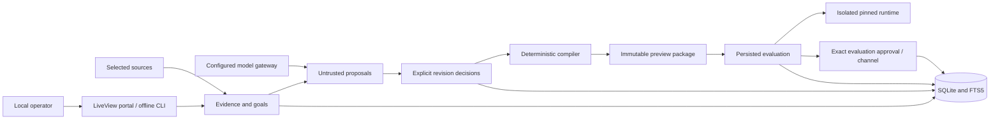

# Architecture

HarnessForge is one local Elixir/OTP application. Phoenix LiveView provides the
portal; the CLI calls the same contexts. SQLite/FTS5 stores durable state. Oban
OSS 2.24.2 uses its Lite engine and a serialized queue. There is no Redis,
external SQL server or private organization infrastructure dependency.

## Context ownership

| Context | Responsibility |
| --- | --- |
| `Workspaces` | Ownership, identity, private paths and local login/session material |
| `Evidence` | Connections, revisions, citations, search and proposed claims |
| `Goals` / `Decisions` | Owner/acceptance criteria and exact revision authority |
| `Models` | Adapters, consent, reservations, usage ledger and proposal validation |
| `Contracts` / `Compiler` / compiled-in `Adapters.Registry` | Versioned validation and deterministic native preview compilation |
| `Artifacts` / `Harnesses` | Integrity, lineage, immutable storage and safe export |
| `Execution` / `Evaluations` | Confinement, lifecycle, task/diagnostic identity and cleanup |
| `Releases` | Applicable qualified evaluation approval and local channel history |
| `Privacy` | Inventory, purge, snapshots, quarantined restore and reconciliation |
| `Audit` / `Jobs` | Safe local events and bounded durable operations |

The `rest_for_one` tree places ownership before Repo/startup recovery, then Oban
and the endpoint. Losing an earlier dependency restarts later dependants. This
single-owner local design serializes schema/recovery preparation under the
workspace lock; it is not a shared-database multi-node migration design.

## Authority and data flow

Source content, filenames and model output have no execution or approval
authority. Citations bind a source revision, byte range and content identity.
Claims remain proposed until a human approves their exact revision hash. The
domain builder rechecks approval, source eligibility and lineage; the pure
compiler cannot grant authority.

Compilation canonicalizes a validated snapshot and renders fixed templates.
Manifests hash sorted file entries and compiler/adapter/spec identities, excluding
the manifest itself to avoid self-reference. Native preview/capability reports
state which behavior is advisory, unsupported or unverified. Identical compiler
inputs produce identical package bytes. Model inference and complete platform
release archives do not carry that determinism guarantee.

Evaluation outcomes come from implementation-owned graders and observed runtime
results. Candidate-writable files cannot define trusted checks. Static integrity
and runtime diagnostics remain unqualified. Release promotion requires a passing
task result matching artifact, runtime, effective config, environment,
suite/fixture/grader, policy and model identity, confirmed cleanup, and a separate
owner decision.

## Trust boundaries

- The operator account, its filesystem and configured local model service are
  trusted. Another process with the same OS permissions can read data or race
  filesystem operations.
- The portal binds loopback, requires a workspace code and checks origin,
  CSRF/session state. It has no publicly exposed multiuser profile.
- Connectors validate origin/scope, reject redirects, resolve environment
  credential references, bound responses and read only. Missing remote items
  do not imply deletion; observed revocation is not continuous ACL attestation.
- Model calls use explicit destinations and cloud source/data consent with a
  shared budget ledger. Responses cannot approve themselves.
- Imported/generated code never runs on the host. The pinned Docker backend uses
  fixed resource/permission/network policy. The daemon/kernel are trusted; this
  is not resistance to Docker/kernel vulnerabilities.

Original sources, exports, backups and external provider copies have separate
lifecycles. See [privacy](privacy.md). Logical purge is not physical erasure.

## Extension and packaging policy

Adapters are compiled-in behaviours. Untrusted input cannot create atoms/modules
or install plugins. Add an adapter plus conformance tests rather than dynamic
executable config. See [contracts](contracts.md) and
[contribution rules](../CONTRIBUTING.md).

Platform packages use built-in `mix release`, prebuilt assets, lockfiles and a
native target build. Docker/OpenCode images and model weights are separate.
Hot upgrades and multi-node operation are unsupported; stop/restart preserves
durable state.

## Additional coding targets and cloud authoring APIs

The compiler selects the registered runtime from the canonical spec for both
native rendering and manifest identity; default OpenCode artifacts remain
byte-compatible. Codex and Claude renderers contain no execution or authentication.
Evaluation identity and dispatch check the target before using a backend; unsupported
managed targets persist blocked, while static artifact integrity remains usable.

OpenAI Responses and Anthropic Messages are optional authoring model providers,
selected explicitly alongside legacy Chat Completions and Ollama. Configuration
binds cloud consent to provider/endpoint/source IDs/data categories. All requests
share the durable ledger and proposal validation; no provider response becomes an
approval, and authoring API support does not enable a new coding execution route.

## Conversational evidence

`Chat` composes the existing evidence and inference contexts. Bounded lexical
retrieval covers all active connector types; exact UTF-8 excerpts bind answers to
current source revisions. Local search needs no model. AI synthesis selects a
compiled chat profile through `Models.infer`, retains the shared run budget and
requires `source_body` plus `chat_context` cloud consent. Neither prompt nor
schema can be overridden by a connector or browser request.

The authenticated LiveView holds a bounded transcript, with no chat database
table or transcript job arguments. It revalidates reply scope, drops stale async
completion, and clears withdrawn context. Sync is a separate selected user
action; model responses never become connector commands, claims or approvals.
