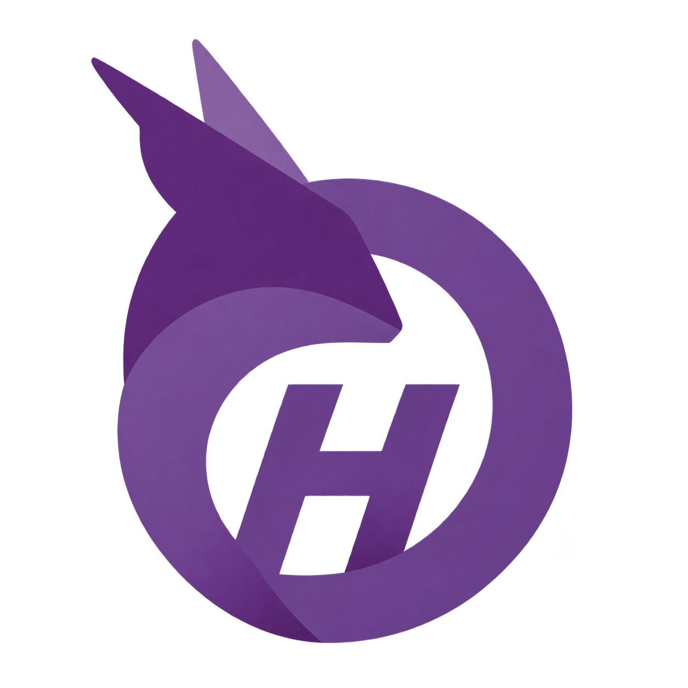

# Olivium Harness branding

Product name: **Olivium Harness**. Repository: [oudaykhaled/olivium-harness](https://github.com/oudaykhaled/olivium-harness). Tagline: **Context in. Capability out.**

The approved mark is the purple Olivium H monogram. The italic O belongs to the landing-page animation, not the static logo.

The original approved PNG is preserved byte-for-byte. SHA-256: `873cd74fc7ddf214be4e4ca9f513c5cd151e3b3ad2ccdfb63d101f1b6b360cad`.

This repository was previously named HarnessForge. Existing CLI commands (`bin/harnessforge`), Elixir modules, environment variables (`HARNESSFORGE_*`) and package formats retain their current names for compatibility.
