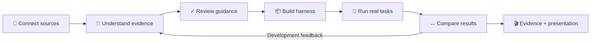
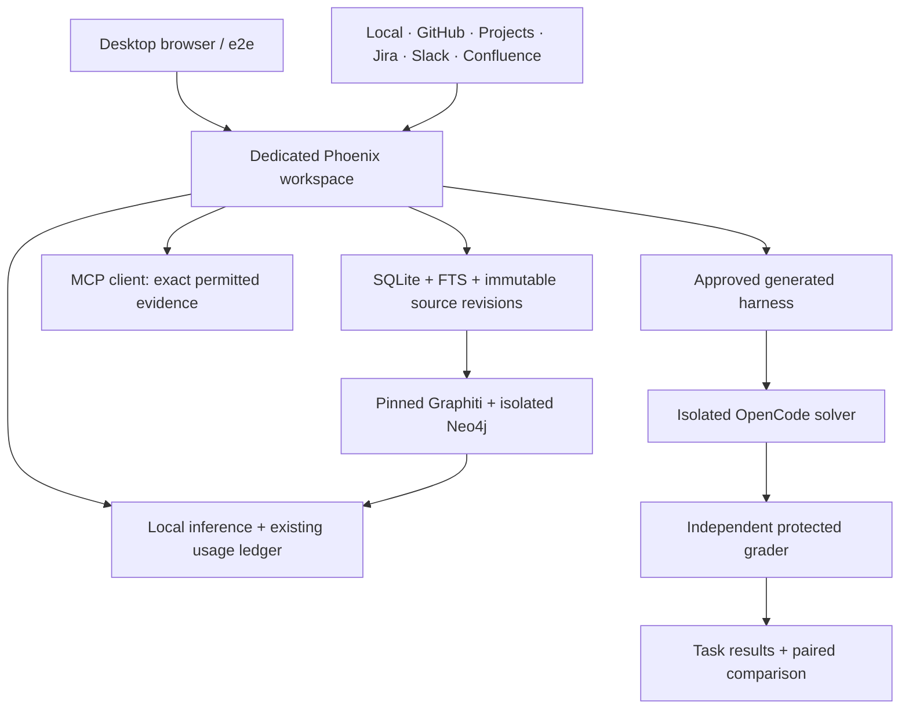
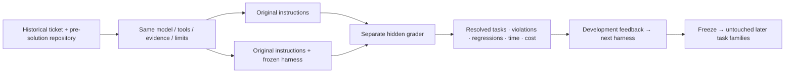

# HarnessForge — desktop functionality and evidence plan

4 November 2026 · **Phase 1 complete: planning only** · Root owns integration and the progress board.

Team: **2 Astra x-high + 5 Sol x-high**. Planning covered critical sequencing/usefulness, media constraints, connectors, environment, UX, E2E and presentation. No product changes, new inference, E2E runs or media were produced in this phase. The existing login returned HTTP 200.

## The product journey

Desktop only. Prioritize working actions, saved context, actual output and short statuses. Mobile, responsive-layout and accessibility campaigns are outside this phase. Reuse Phoenix, existing components, SQLite/FTS, Graphiti, Jev, the execution lifecycle and the existing e2e project. Do not create a second product, runner, graph engine or roadmap.

## Five delivery milestones

| Order | Deliver | Finish condition | Existing work |
|---|---|---|---|
| 1 | Reproducible environment + connected UX | Dedicated test workspace starts/checks/stops cleanly; setup and harness identity survive every handoff | A10-03, A02-03, A03-01/02/04, A04-01/02/03/04 |
| 2 | All-source acquisition, retrieval, graph and MCP | Each of six inputs has its own contract/live result; real graph ingest/search; actual MCP client checks | A08-01/04/05, R02, A05-01/02, A09-02/03 |
| 3 | One complete real harness run | Real model proposal → exact review decisions → generated files → physical agent edit → protected tests → cleanup | A04-02, A09-04, A06-02, A10-03 |
| 4 | Historical-task comparison and improvement | Frozen baseline/candidate pairs, honest failures and costs, development feedback, later untouched evaluation | A06-01/02/03/04 |
| 5 | Recorded showcase and presentation | Step evidence links, supported videos, permitted screenshots and a short deck matching actual results | A10-03, A03-04 |

Run at most **three implementation lanes**: (1) environment/runtime, (2) connectors/retrieval/MCP, (3) desktop UX/E2E. Root is coordinator and sole board writer; if root edits implementation, one lane pauses to preserve the three-author limit. Use Sol x-high for bounded changes. Use Astra for experiment design, runtime/capture decisions and critical review. Reuse these agents; no new planning fan-out per ticket.

Milestones may overlap where independent. Prove one working end-to-end path early; keep the remaining connector rows open until individually verified. Full completion still requires every requested connector and the media deliverables. Do not wait for all 67 roadmap tickets to improve the working journey, or mark those tickets complete from a narrower slice.

## Environment: reuse what exists

- **Candidate:** extend installed WEB20 staging at `tmp/ticket-delivery/A03-visible-02/web-source`. Main contains unfinished R01; never install it wholesale. Preserve the current app and workspace.
- **Lifecycle:** add only a thin local launcher/manifest around existing application, workspace and resource ownership. Start/check/stop/reset must target its own workspace, processes and containers. No global prune. A fresh data workspace is for reproducibility; it does not remove capture restrictions.
- **Data:** reuse physical company-assessment documents and the finite Go task seeds. Seed through normal supported application APIs. Never seed prewritten model findings, oracle results or approvals and call that synthesis. Keep hidden tests and answers outside retrieved/solver inputs.
- **Models:** verify installed local model identity/capabilities; route real requests through existing authorization, ledger and cancellation. Declare an aggregate cap for each new campaign, retaining prior uncertain requests and charges. Local test authorization is not permission for paid cloud calls or private-source imports.
- **Graph:** reuse pinned Graphiti 0.31.2, its worker and Neo4j 5.26.32 lifecycle. Wire validated image configuration; qualify extraction, summary, node/edge deduplication and a compatible 1024-dimension embedder. The recorded Qwen completion model is not an embedder. FTS success cannot qualify graph search; FTS/graph fusion remains A05-02 work.
- **Execution:** qualify the existing OpenCode 1.19.5 isolated route first. Require real changed files, actual model usage, independent grading and cleanup. Its current two Go tasks are a mechanical smoke test, not company usefulness evidence.
- **Codex:** keep separate until its helper-path, namespace and command-bridge problems are solved under supported isolation. A different VM alone is not a demonstrated remedy. No host execution or privilege weakening.
- **MCP:** enable only the dedicated test instance and verify all **four** current metadata tools against a real client. Correct the stale three-tool documentation. Source-reading retrieval additionally requires the existing A09-02/03 disclosure/EvidenceBundle work; metadata-only success does not complete it.

## Every source gets a visible result

Use one small synthetic company narrative across provider sandboxes and local files: current rule, contradictory historical practice, explicit decision, issue/PR/review, board field, Jira transition, Slack reply/edit and Confluence edit. Preserve exact selected IDs and capture hashes.

| Source | Scope to test | Current evidence | Live completion requirement |
|---|---|---|---|
| Local files | UTF-8 text/Markdown, bounded directory capture, changed file | Physical synthetic capture/retrieval exists | Fresh normal import, exact citations, change recovery |
| GitHub repository | Metadata, issue/PR bodies, PR reviews | Historical partial public capture; account metadata verified separately | Selected repository capture, pagination/provenance and repeat-sync checks |
| GitHub Projects v2 | Fields/options, views, items and values | Adapter tests; live access unresolved | Selected project and API credential with Projects read permission |
| Jira Cloud | Issues, descriptions and status changelog | Adapter tests; live unqualified | Selected test project and direct-tenant API access |
| Slack | Joined channel messages, threads and edits | Adapter tests; live unqualified | Selected test channel and appropriate user-token scopes |
| Confluence Cloud | Selected space, current pages and version provenance | Adapter tests; live unqualified | Selected test space and direct-tenant API access |

For each: distinguish **Account connected**, **Captured**, **Incomplete**, **Failed**, and **Live verified**. Account listing and content ingestion are different checks. Exercise continuation, unchanged resync, failure/retry and access-loss behavior. Do not assert deletion/continuous ACL support that the adapter does not provide.

Existing credential/resource-selection requests for Projects, Slack and Atlassian remain pending; do not repeat them unchanged. Use existing deterministic transport tests while those live checks are blocked. No fake provider status or production-host allowlist relaxation.

“All connectors” here means the six implemented input types. Drive, Notion, Teams, GitLab and other roadmap connectors are unimplemented expansions, not implicitly covered. GitHub repository files/comments/history and Jira comments/issue–PR links also require A08-02/03 work before claiming a complete historical cohort.

## UX: six states, one clear next action

| State | Show first | Primary action | Details stay behind inspection |
|---|---|---|---|
| Home | Current project, one status, saved harnesses | Continue / Open harness | Technical readiness and identifiers |
| Sources | Provider icons, selected scope, per-source status | Connect / Capture / Continue | Credentials, cursor and omission details |
| Review | Proposed guidance, conflict status, evidence counts | Review / Approve guidance | Full report, exact passages and hashes |
| Build | Target and approved rule count | Approve plan, then Build | Full immutable plan and provenance |
| Harness | Actual files and open AGENTS.md | Download | Integrity and historical qualification |
| Results | Same task: baseline versus harness | Inspect results / Improve | Full logs, resource use and detailed diffs |

Status vocabulary: `○ Not started` · `◌ Working` · `✓ Saved/Generated` · `⚠ Review` · `⊘ Unavailable` · `? Unmeasured`. Attach status to a specific result; do not invent one overall green score. Keep essential control names and confirmations understandable.

First fixes:
1. Analysis completion must open its exact current findings and retain the saved setup return path.
2. “Check a task” must carry and validate the harness digest, retaining it on reload.
3. Connect/capture must return to setup with saved scope; remote capture must join the same retrieval journey.
4. Empty selectors must offer the existing creation route and return to the saved setup.
5. Collapse repeated reports, technical hashes and warnings. Once built, replace the primary Build action with Open harness.
6. Show comparison metrics only when recorded. Owner-reported assessments stay labelled; missing baseline means **Benefit unmeasured**.

Accept when every state has one obvious next action, no scope/artifact handoff is lost, reload never dispatches duplicate work, and users can reach the exact generated files without verbal navigation. A short first-use walkthrough measures task completion and unintended approvals, not pixel polish.

## Real E2E evidence

Extend the existing A02 browser project; one desktop worker, fresh output per run, real UI actions and assertions. Reuse exact ZIP checking. Preserve runner-generated reports unchanged.

| Scenario | Assertions | Required evidence |
|---|---|---|
| 1. Connect and capture | Exact scope, bounded pages, stable identities, honest omissions/errors | Per-source results and sanitized cursor/source receipts |
| 2. Find and inspect | Current exact citations, contrary evidence, real graph lineage, actual MCP client | Retrieval/graph IDs, passage hashes and MCP transcript |
| 3. Propose guidance | Real model terminal result, cited claims, settled/uncertain accounting, no duplicate on reload | Model request/usage and proposal records |
| 4. Review | Missing decision refuses; edited revision preserved; claim and plan decisions separate | Revision differences and explicit UI decision receipts |
| 5. Generate and download | Approved guidance included; rejected guidance excluded; all payload bytes exact | Artifact manifest, actual browser ZIP and per-file verification |
| 6. Execute and compare | Same task/model/limits; physical edits; protected tests; cleanup; mismatches refuse comparison | Both patches, grader outputs, usage and runtime receipts |
| 7. Recover | Source change withdraws stale use; current review opens; fresh decisions required | Before/after lineage, denial and successor result |

Each meaningful step gets an assertion and video timestamp; screenshots remain required but separately gated below. One small evidence index records build/source hash, scenario/step/attempt, input qualification, timestamps, media paths, receipt hashes and blockers. Do not create another reporting system. Existing WEB19 full-suite and WEB20 focused results remain historically labelled.

## Prove usefulness, then improve

1. First run the two existing Go tasks to prove plumbing. Do not use company release-policy guidance to claim benefit on unrelated Go utilities.
2. Before historical evaluation, qualify A06-02 on one real repository task with pinned dependencies: freeze the solver patch, grade separately, require the base/empty patch to fail and both reference and alternate correct patches to pass. The two Go smoke tasks do not establish this capability.
3. Admit historical tasks only with reconstructable ticket/repository/evidence versions before the first solution-bearing event. Use cutoff-specific source packages, indexes, graph partitions and caches; verify a future-answer sentinel cannot be retrieved. Keep solution PRs, future Git objects, answer summaries and hidden tests outside solver/retrieval access. Include harness-authoring and feedback lineage in the cutoff. Group duplicate/backport/shared-fix families before splitting. If historical separation cannot be demonstrated, label the cohort a current-knowledge diagnostic.
4. Freeze a two-arm comparison: original eligible instructions versus those instructions plus the generated harness. Keep model/version, tools, evidence access, budgets and starting tree equal; use fresh environments and randomized order.
5. Grade behavior and regressions independently after the solver stops. Require base-fails/reference-passes and a genuinely executed test count. Real PR comparison checks requirements and behavior; textual diff similarity is not correctness.
6. Start with a small development cohort, expand only after admissibility and grading work. The existing 12-ticket proposal would be 48 trials at two arms/two repetitions; that is a capped development option, not an automatic spend authorization or enough evidence for a broad claim.
7. Improve from development failures, freeze the next candidate, then test later untouched task families. Before opening holdout, freeze the primary metric (resolved-and-compliant / all admitted scheduled trials), useful-effect threshold, critical-regression limit, stopping/retry rules and sample-size rationale. Do not feed sealed holdout details into the next iteration and keep calling it a holdout.
8. Report all scheduled trials, including timeouts, abstentions, regressions and uncertain sends. Show paired results, sample size, uncertainty, actual resource use and harness construction cost. Compute uncertainty over independent task families; repetitions do not increase that sample size. A null or harmful result is a valid finding. Public tasks cannot prove absence of model pretraining exposure.

This initial two-arm study deliberately narrows A06's broader six-arm roadmap. It does not close the full ticket. One task pair demonstrates an observation, not company-wide productivity.

## Media and the presentation

**Correction to the old handoff:** supported human-viewable video and authenticated screenshots have different rules.

- The installed runner documents `start_recording` / `stop_recording` after secret entry **for a person to watch**. Verify the real session capability, record via those supported tools, and retain the original file and timestamps. It is unmasked output; no assistant visual-inspection claim or automatic public upload. No video attempt has occurred in this phase.
- Authenticated screenshots remain blocked by `PIXEL_TAINTED`. No documented post-fill release was found. Do not reset the session, switch capture tools, bypass login, extract video frames or patch the guard to obtain them.
- Completing the screenshot-led deck therefore needs reviewed/redacted screenshots supplied by the user, or a supported upstream artifact-review/release capability. This is a genuine outstanding dependency; semantic logs and diagrams do not satisfy screenshot evidence. The unchanged runner feedback has already been filed; do not resend it.

| Slide | Main visual/evidence | On-slide copy |
|---|---|---|
| 1 | Actual Home and next action | Your workspace |
| 2 | Six-source status view + provider video chapters | Source connections |
| 3 | Exact citation and selected evidence | What the harness learns |
| 4 | Real model proposal and cited conflict | Suggested guidance |
| 5 | Actual guidance and plan review | Review, then build |
| 6 | Real AGENTS.md/files and ZIP result | Your harness |
| 7 | Agent patch and protected-test outcome | It runs real tasks |
| 8 | Paired task outcomes, failures included | Did it help? |
| 9 | Source-change recovery | Keep it current |
| 10 | Compact result matrix with evidence links | Verified / Blocked / Unmeasured |

Use roughly 80% of each slide for authentic visuals and no more than 12 overlay words, excluding readable app UI. Keep logs, hashes and full methodology in linked evidence. Final deliverables: a short deck (editable + PDF), original supported videos, permitted step screenshots, generated harness ZIP and the evidence index. Never use mock UI or historical images as current screenshots.

## Source anchors and decisions

Installed-source references below use `tmp/ticket-delivery/A03-visible-02/web-source/` under this repository:

| Decision | Grounding |
|---|---|
| Preserve deployed source and limits | `docs/ticket-delivery/CURRENT_HANDOFF.md`; `AGENTS.md` |
| Six input types / account separation | `lib/harness_forge/connectors/registry.ex:5`; `connectors/{github,github_projects,jira,slack,confluence}.ex`; `evidence/local_import.ex:2`; `connectors/service_account.ex:34` |
| Fix lost setup and artifact context | `lib/harness_forge_web/live/setup_live.ex:751`; `live/harness_live.ex:327`; `live/portal_live.ex:130` |
| Existing output and review components | `components/company/guide.ex:478`; `components/company/analysis.ex:478`; `components/company/plan.ex:410` |
| Current finite execution / comparison | `lib/harness_forge/evaluation/task_suite.ex:5`; `execution/coding.ex:3`; `execution/codex.ex:203`; `evaluations.ex:354` |
| Graph configuration and stages | `lib/harness_forge/graphiti/runtime.ex:247`; `priv/graphiti_worker/runtime.py:173`; `company/retrieval.ex:436` |
| Four current MCP tools | `lib/harness_forge/mcp/tools.ex:32`; source-reading additions remain A09-02/03 |
| Video contract vs screenshot restriction | `../testerarmy/node_modules/e2e/docs/reference/mcp.mdx:162`; `security.mdx:98`; `dist/mcp/recording.js:8` |
| Existing actual browser/download proof | `tmp/ticket-delivery/takeover/{browser-calls01,zip-verification01,cli-verification01}.json` |
| Canonical tickets | `../harnessforge-plan/github-roadmap-2026-11-02/{TICKET-INDEX.md,A03.md,A04.md,A06.md,A08.md,A09.md}` |

All seven planners completed. Astra's final review added the real-repository execution gate, physical historical-data separation and predefined usefulness criteria. The plan is ready for bounded implementation; it is not evidence that the environment, complete live connector coverage, real synthesis, historical benefit study or requested media have been delivered.
